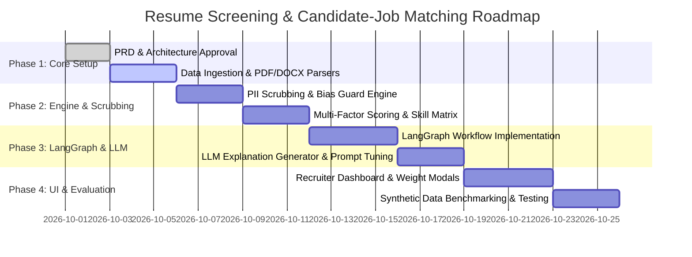

# Product Requirement Document (PRD)
## AI-Powered Resume Screening & Candidate-Job Matching System

---

| **Document Version** | 1.0.0 |
| **Status** | Approved / Design Phase |
| **Use Case ID** | Use Case 9 |
| **Target Audience** | Technical Recruiters, HR Operations, Hiring Managers, Talent Acquisition Teams |
| **Author** | AI Systems Engineering Team |
| **Last Updated** | September 2026 |

---

## 1. Executive Summary

The **AI-Powered Resume Screening & Candidate-Job Matching System** is an intelligent talent acquisition platform designed to automate and objectify the candidate evaluation workflow. By analyzing unstructured Job Descriptions (JDs) and batches of candidate resumes (PDF, DOCX, TXT), the system extracts granular requirements and qualifications, computes multi-dimensional candidate match scores, isolates matching and missing skills, and delivers plain-language explanations powered by Large Language Models (LLMs).

Built with a **bias-mitigation-first architecture** and an optional **LangGraph modular workflow**, this tool provides hiring teams with a transparent, configurable, and verifiable candidate shortlist.

---

## 2. Problem Statement & Business Objectives

### 2.1 Problem Statement
Recruiters spend hundreds of hours manually reviewing unstructured candidate resumes against job requisitions. Traditional Keyword-based Applicant Tracking Systems (ATS) fail to grasp semantic equivalencies (e.g., recognizing that candidate experience in *GCP* provides relevant background for an *AWS* cloud requirement, or equating *Data Science* with *Machine Learning Engineering*). Furthermore, manual screening introduces unconscious human bias based on candidate names, demographics, graduation dates, or alma maters.

### 2.2 Core Objectives
- **Semantic Understanding**: Transition from strict keyword matching to LLM-driven semantic qualification matching (e.g., recognizing alternative tools, frameworks, and equivalent experience).
- **Explainable AI (XAI)**: Eliminate "black box" candidate scoring by providing clear, evidence-backed matching vs. missing skill breakdowns and explicit reasoning notes.
- **Bias Reduction**: Implement automatic Personally Identifiable Information (PII) and demographic scrubbing prior to LLM scoring.
- **Resilience & Fault Tolerance**: Safely handle corrupted files, incomplete job descriptions, and empty submissions without system failure.
- **Configurable Evaluation**: Allow recruiters to customize scoring weights (Skills vs. Years of Experience vs. Education/Certifications) per role.

---

## 3. High-Level User Flow

```mermaid
flowchart TD
    A[Recruiter Logs In / Opens App] --> B[Upload Job Description & Batch Resumes]
    B --> C{Validation Check}
    C -- No Resumes Uploaded --> D[Prompt: Add at least 1 Resume]
    C -- JD Missing Key Fields --> E[Prompt: Enter Role Title & Core Skills]
    C -- Valid Inputs --> F[Pre-Processing & PII Scrubbing Engine]
    F --> G[LangGraph Pipeline Orchestration]
    
    subgraph LangGraph Flow
        G1[Node 1: Resume & JD Structured Parsing] --> G2[Node 2: Multi-Factor Scoring Engine]
        G2 --> G3[Node 3: LLM Explanation Generator]
    end
    
    G --> LangGraph Flow
    LangGraph Flow --> H[Ranked Candidate Dashboard]
    H --> I[Filter / Sort / Expand Candidate Details]
    H --> J[View Unprocessable Files Queue]
    H --> K[Re-run Evaluation with Custom Weights]
```
---

## 4. Detailed Functional Requirements

### 4.1 Input & Upload Module
- **FR-1.1 Job Description (JD) Input**:
  - Accept direct text paste or file upload (`.pdf`, `.docx`, `.txt`).
  - Automatic extraction of Required Role Title, Mandatory Skills, Preferred Skills, Minimum Years of Experience (YOE), and Education/Certification preferences.
  - **Validation Guard**: If JD lacks essential fields (e.g., empty text or no explicit role/skills found), prompt user to supply role title and mandatory skills before proceeding.
- **FR-1.2 Batch Resume Upload**:
  - Drag-and-drop file upload supporting up to 50 resumes simultaneously.
  - Accepted file formats: PDF (`.pdf`), Microsoft Word (`.docx`), Plain Text (`.txt`).
  - **Validation Guard**: If 0 resumes are uploaded, block evaluation and display inline warning prompt.
- **FR-1.3 File Corruption & Error Handling Queue**:
  - If a file is encrypted, corrupt, unreadable, or image-only without OCR compatibility, isolate the file safely.
  - Append the file to a **"Could Not Process"** section with specific reasons (e.g., `Unreadable PDF structure`, `Empty document`), preventing batch failure.

---

### 4.2 Bias Mitigation & Safeguards Engine
- **FR-2.1 Demographic Data Scrubbing**:
  - Before sending resume data to the scoring and LLM logic, strip/mask all demographic and PII fields:
    - Candidate Full Name (replaced with synthetic Candidate ID, e.g., `Candidate #104`)
    - Email address, Phone number, Physical address
    - Gender indicators, pronouns, photos
    - Graduation years (to prevent age discrimination)
    - Name of academic institutions (to reduce institution prestige bias)
- **FR-2.2 Toggleable Anonymization View**:
  - Recruiters can toggle "Blind Review Mode" ON/OFF in the UI dashboard.

---

### 4.3 Structured Parsing Engine
- **FR-3.1 Schema Standardization**:
  Extract data into a standardized JSON structure for both JDs and Resumes.
  
  ```json
  {
    "candidate_id": "CAND-7842",
    "years_of_experience": 4.0,
    "primary_skills": ["Python", "SQL", "GCP", "Docker"],
    "secondary_skills": ["Git", "REST APIs"],
    "education": {
      "degree": "Bachelor of Science",
      "field": "Computer Science"
    },
    "certifications": ["GCP Professional Data Engineer"]
  }
  ```

---

### 4.4 Configurable Scoring & Matching Engine
- **FR-4.1 Multi-Factor Weighted Scoring Algorithm**:
  - Total Match Score ($S_{total}$) is calculated using configurable weights:
    $$S_{total} = (W_{skill} \times S_{skill}) + (W_{yoe} \times S_{yoe}) + (W_{edu} \times S_{edu})$$
    *(Default weights: $W_{skill} = 0.60$, $W_{yoe} = 0.25$, $W_{edu} = 0.15$)*
- **FR-4.2 Semantic Skill Gap Analysis**:
  - Categorize extracted skills into:
    - **Matching Skills**: Exact or semantically equivalent skills present in both JD and Resume.
    - **Missing Skills**: Required skills missing from the resume.
    - **Substitute/Equivalent Skills**: Skills that serve as partial or full replacements (e.g., *GCP* present when *AWS* required).
- **FR-4.3 Score Scaling**:
  - Scores normalized strictly between 0% and 100%.

---

### 4.5 LLM Explanation & Recommendation Engine
- **FR-5.1 Natural Language Explanation Generation**:
  - Generate a concise (2-3 sentence) plain-language rationale for every candidate.
  - Highlight key strengths, direct skill overlaps, critical gaps, and compensating factors.
  - *Sample Rationale Output*:
    > **Match Score: 78%** | **Matching**: Python, SQL | **Missing**: AWS (has GCP instead)
    >
    > **Note**: *"Strong technical fit with 4 years of Python and SQL experience. While the candidate lacks AWS experience, their 4 years of GCP cloud experience provides strong transferable knowledge for the role."*

---

### 4.6 Bonus Architecture: LangGraph Modular Pipeline
- **FR-6.1 Agentic Graph Pipeline**:
  - Implement parsing, scoring, and explanation steps as discrete LangGraph nodes:
    1. `ParserNode`: Extracts schema from raw text.
    2. `ScorerNode`: Runs mathematical skill vector comparison and experience weighting.
    3. `ExplainerNode`: Invokes LLM with parsed facts to produce narrative summary.
  - **Inspection & Independent Re-runs**: Recruiters can view intermediate node outputs and trigger re-execution of individual steps (e.g., re-running explanation with a different LLM temperature or re-scoring with modified weights) without re-parsing raw files.

---

## 5. User Interface (UI) & User Experience (UX) Specifications

### 5.1 Main Layout & Components
1. **Header Bar**: App title, Blind Mode Toggle switch, Weight Configuration Modal trigger button.
2. **Dual Upload Panel**:
   - Left Card: Job Description Input (Text area + File drop area + Extract Status badge).
   - Right Card: Batch Resumes Drop Zone (Supports multi-file select, progress indicator, file count pill).
   - Action Button: **"Run Candidate Matching"** (Primary CTA).
3. **Weight Configuration Modal / Drawer**:
   - Interactive sliders for Skill Weight (%), Experience Weight (%), and Education Weight (%). Total must sum to 100%.
4. **Ranked Candidate Shortlist Table**:
   - Columns:
     - `Rank` (#1, #2, #3...)
     - `Candidate` (Name or Anonymized ID `Candidate #104`)
     - `Match Score` (Visual Badge: Green >80%, Yellow 60-79%, Red <60%)
     - `Matching Skills` (Green Tags)
     - `Missing Skills` (Red / Neutral Tags with substitute annotations)
     - `Actions` (Expand Row for Explanation / View Original Resume)
   - Expandable Row: Displays full LLM Explanation Note, breakdown of YOE comparison, education details, and LangGraph execution trace log.
5. **Unprocessable Files Accordion / Drawer**:
   - Tab showing list of skipped files, filename, error code, and suggestion (e.g., `resume_john_scan.pdf - Image PDF: OCR required`).

---

## 6. Edge Cases & Error Handling Matrix

| Scenario / Edge Case | Detection Trigger | System Behavior | User Interface Impact |
| :--- | :--- | :--- | :--- |
| **No Resumes Uploaded** | User clicks "Run Candidate Matching" with 0 files in queue | Intercept execution immediately | Display toast notification & highlight Resume Drop Zone in red: *"Please upload at least one resume."* |
| **Missing/Vague JD** | JD parser extracts < 1 mandatory skill or empty text | Pause execution before scoring | Open inline prompt requesting Recruiter to provide Role Title & Mandatory Skills. |
| **Corrupted / Scanned PDF** | File parsing fails due to bad encoding or missing text stream | Catch exception gracefully | Skip file, log error, add file to **"Could Not Process"** list. Do not crash batch. |
| **Duplicate Resumes Uploaded** | Identical filename or hash detected in batch | De-duplicate automatically | Display notice: *"1 duplicate file skipped (resume_v2.pdf)"*. |
| **Overqualified / Non-standard Career Path** | Candidate YOE > 2x required, or alternative titles | Flag in scoring without penalizing skills | Explanation note highlights candidate background context. |

---

## 7. Synthetic Data Strategy & Test Bench

To validate system accuracy without privacy concerns, the system uses a benchmark dataset of synthetic job descriptions and resumes.

### 7.1 Sample Job Descriptions
- **JD 1 (Senior Backend Engineer)**: 3+ years Python, SQL, AWS, Docker.
- **JD 2 (Frontend Developer)**: 2+ years React, TypeScript, CSS, REST APIs.
- **JD 3 (Data Scientist)**: 3+ years Python, SQL, Machine Learning, BigQuery, Statistics.

### 7.2 Sample Synthetic Resumes (10-20 Resumes)
- **Candidate A**: 4 YOE Python, SQL, GCP (Expected Score: ~75-80%, missing AWS, has GCP).
- **Candidate B**: 3 YOE Python, SQL, AWS, Docker (Expected Score: ~95-100%, exact match).
- **Candidate C**: 1 YOE Python, HTML, No SQL/AWS (Expected Score: ~35-45%, missing experience & AWS/SQL).
- **Candidate D (Corrupt file)**: Corrupted PDF binary stream (Expected: Handled in "Could Not Process").

---

## 8. Technical Architecture & Tech Stack

```
+-----------------------------------------------------------------------+
|                           FRONTEND LAYER                              |
|   React + Vite / Tailwind CSS / Lucide Icons / Recharts / Modern UI   |
+-----------------------------------------------------------------------+
                                   | REST API / WebSockets
+-----------------------------------------------------------------------+
|                            BACKEND LAYER                              |
|    FastAPI (Python) / Pydantic Schemas / PDF & DOCX Parsing Engine    |
+-----------------------------------------------------------------------+
                                   |
+-----------------------------------------------------------------------+
|                     LANGGRAPH AGENT FLOW ENGINE                       |
|  +--------------------+   +-------------------+   +----------------+  |
|  | Parsing Node       |-->| Scoring Node      |-->| Explainer Node |  |
|  | (PII Scrubbing &   |   | (Vector Similarity|   | (LLM Rationale |  |
|  | Requirement Extraction)| | & Weighted Formula)|  |  Generator)    |  |
|  +--------------------+   +-------------------+   +----------------+  |
+-----------------------------------------------------------------------+
                                   |
+-----------------------------------------------------------------------+
|                    LLM INTEGRATION & PERSISTENCE                      |
|   LM Studio Server (http://localhost:1234/v1) - nemotron-3-nano-4b    |
|   PostgreSQL (SQL Metadata)  |  MongoDB (NoSQL Resumes & Traces)       |
+-----------------------------------------------------------------------+
```

### 8.1 Stack Selection Rationale
- **Frontend**: React + Vite with clean Tailwind CSS styling, responsive tables, dynamic badge components, and interactive modal overlays.
- **Backend API**: Python FastAPI with `pypdf`, `python-docx`, `sqlalchemy` (PostgreSQL), and `motor` / `pymongo` (MongoDB).
- **Relational Storage (SQL)**: PostgreSQL for structured tables (Job requisitions, screening batches, candidate evaluation shortlists, score weights).
- **NoSQL Storage**: MongoDB for storing unstructured/semi-structured scrubbed resume documents, raw JSON parse dumps, and step-by-step LangGraph agent trace logs.
- **Orchestration**: LangGraph for stateful agent flows, allowing visual state inspection and modular node execution.
- **LLM Engine**: LM Studio local server (`http://localhost:1234/v1`) running `nemotron-3-nano-4b` for fast, offline, privacy-safe structured extraction and natural language reasoning.

---

## 9. Success Metrics & Key Performance Indicators (KPIs)

1. **Ranking Quality & Alignment**:
   - **NDCG@5 (Normalized Discounted Cumulative Gain)**: > 0.88 match against human-labeled ground truth shortlist.
   - **Precision@3**: > 90% of candidates ranked in top 3 meet minimum core requirements.
2. **System Reliability**:
   - **Zero Batch Crash Rate**: 100% graceful handling of invalid, corrupt, or empty file uploads.
3. **Explanation Clarity & Actionability**:
   - User satisfaction score > 4.5/5 on explanation usefulness during recruiter feedback trials.
4. **Processing Latency**:
   - Parsing & ranking time < 2.5 seconds per resume. Batch of 20 resumes evaluated within 15 seconds.

---

## 10. Implementation Roadmap



---

## 11. Appendix & Acceptance Criteria Checklist

- [x] Recruiter can upload job description and multiple resumes in PDF, DOCX, or TXT.
- [x] UI displays ranked shortlist with Match Score %, Matching Skills, Missing Skills, and Explanation Note.
- [x] Edge case handled: Empty resume upload displays user prompt.
- [x] Edge case handled: Corrupted resumes are routed to "Could not process" without failing batch.
- [x] Edge case handled: Missing key fields in JD prompts recruiter to enter role title/skills.
- [x] Bias mitigation: PII (names, demographics, photos) scrubbed prior to model scoring.
- [x] Weighting configurable: Recruiters can customize Skill vs Experience vs Education weights.
- [x] LangGraph flow: Modular graph allows inspecting and re-running parsing/scoring/explanation steps independently.
